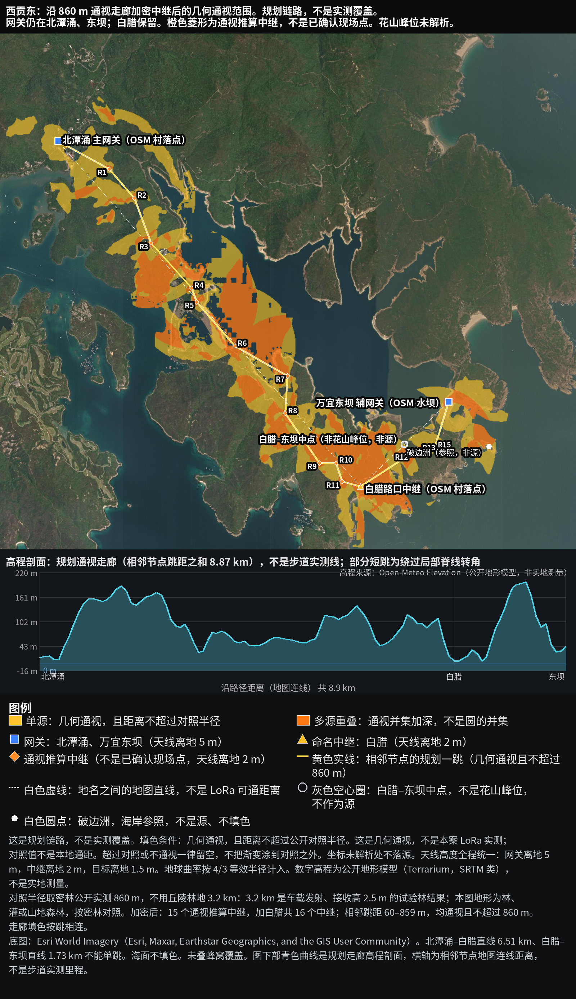
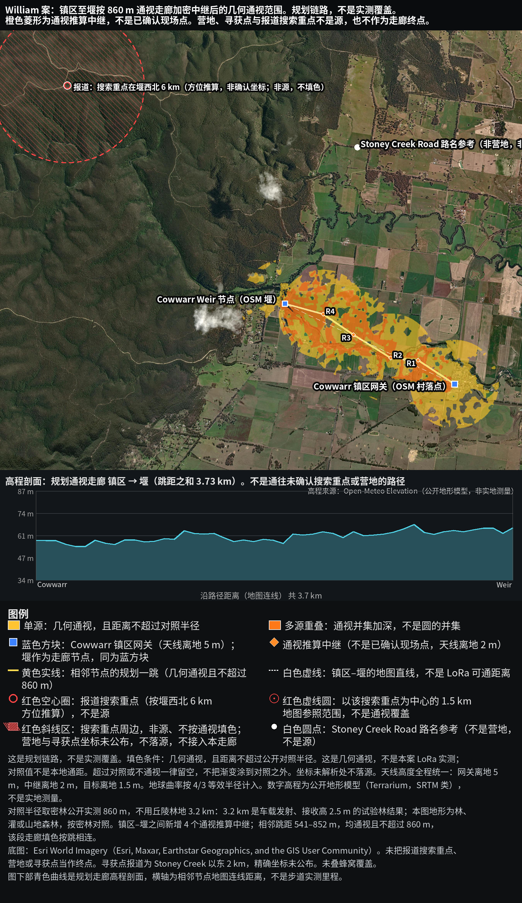
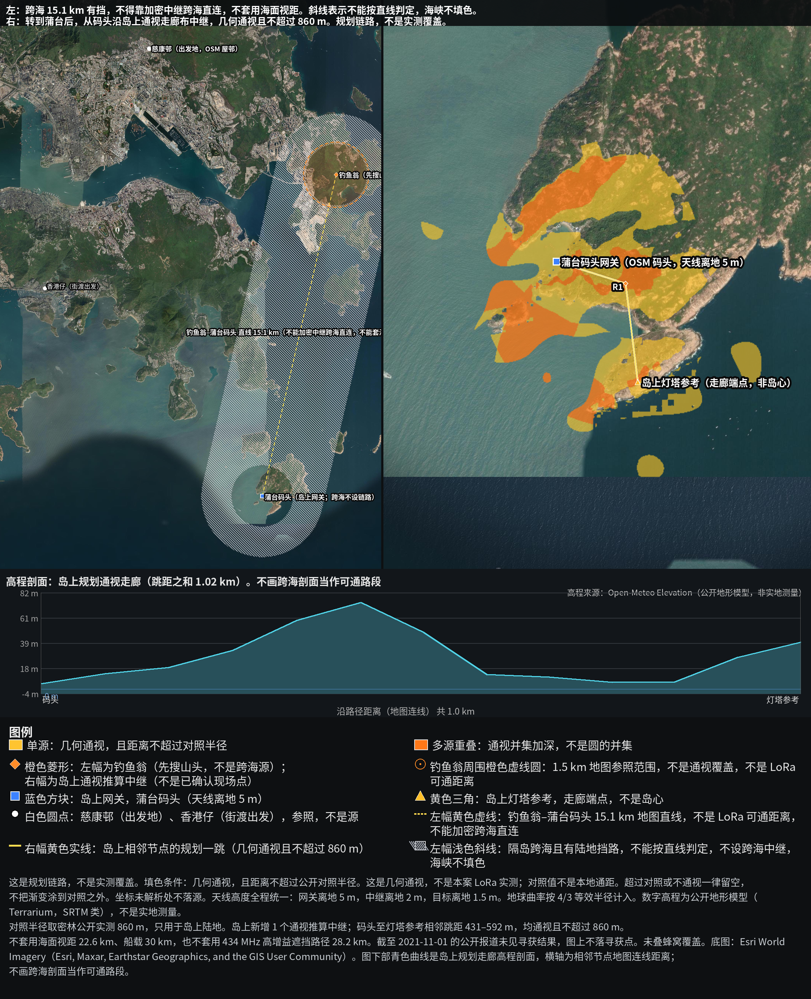
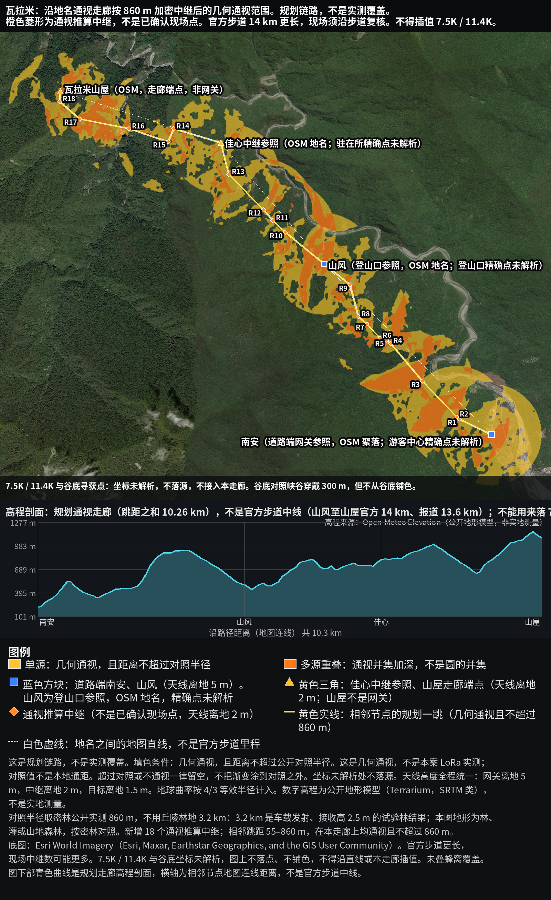
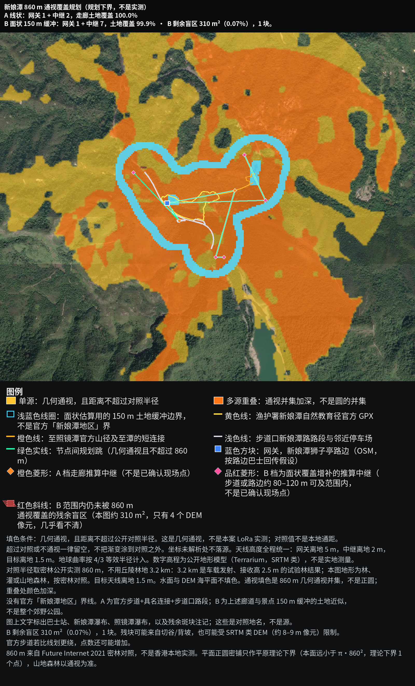

# LoRa mesh 荒野搜救通视规划

五处案例的网关和中继按几何通视布置。网页版：[plan.html](plan.html)（<https://xitingz226-droid.github.io/outdoor-relay/plan.html>）。

佩戴节点用卫星定位取得坐标，经 LoRa 逐跳送到道路端网关，再交到接收端。节点不内置蜂窝模块。链路中断时，接收端保留最后一次收到的位置和时间。

## 通视规则

数字高程用 Terrarium（SRTM 类）。地球曲率按 4/3 等效半径计入。天线高度：网关 5 m（离地），中继 2 m，目标 1.5 m。

只给同时具备几何通视、且平面距离不超过 860 m 的像素上色。填色边缘随地形曲折，不是圆。两个及以上源都能看见的像素颜色加深。脊线背坡、被挡住的谷底、被挡住的跨海和水面留空。

860 m 是密林对照，取自 Future Internet 2021（Ojo 等）：868 MHz，发射 10.4 dBm，SF12，最远点只有少量成功送达。[论文](https://www.mdpi.com/1999-5903/13/5/115)。这不是本地实测通距。图上另行写出的丘陵林地 3.2 km，是车载发射、接收天线高 2.5 m 的试验林结果，不用作本图填色半径。

规划点由通视推算，不是已确认现场点。一跳只连接几何通视且平面距离不超过 860 m 的相邻节点。节点要能沿同一规则跳回至少一处有回传的路边或公路端网关。在这套规则下，规划链相连是必要条件，不足以说明实地可行。

底图是 Esri World Imagery。四张案例图下方的青色曲线是规划走廊高程剖面，横轴是相邻节点地图连线的距离，不是步道实测里程。剖面高程取图上标注的公开地形模型（Open-Meteo Elevation）。

## 图例

五张图共用：

| 符号 | 含义 |
| --- | --- |
| 浅黄填色 | 单源：几何通视，且平面距离不超过 860 m。边缘不规则，不是圆 |
| 深橙填色 | 多源重叠：通视范围叠加后加深，不是圆的并集 |
| 蓝色方块 | 网关，天线离地 5 m |
| 橙色菱形 | 通视推算中继，天线离地 2 m，不是已确认现场点 |
| 黄色三角 | 具名点。西贡为白腊；瓦拉米为佳心与山屋；蒲台右幅为灯塔参考 |
| 黄色实线 | 相邻节点的规划一跳（几何通视且不超过 860 m）。新娘潭图上这条线是绿色 |
| 白色虚线 | 地名之间的地图直线，不是 LoRa 可通距离，也不是步道里程 |
| 青色曲线 | 西贡、William、蒲台、瓦拉米四图下部的规划走廊高程剖面 |

西贡东另有：灰色空心圈是白腊–东坝中点，不是花山峰位，不是源；白色圆点是破边洲海岸参照，不是源，海面不填色。

William 另有：堰与镇区同为蓝色方块，堰是走廊节点；红色空心圈是报道搜索重点，按堰西北约 6 km 的方位推算，不是源；红色虚线圆是以该点为中心的 1.5 km 地图参照，不是通视范围；红色斜线区不是源、不上色；白色圆点是 Stoney Creek Road 路名参考，不是营地，不是源。营地、寻获点和搜索重点都不接入走廊。

蒲台另有：左幅钓鱼翁的橙色标记不是跨海源，周围橙色虚线圆是 1.5 km 地图参照，不是通视；左幅黄色虚线是钓鱼翁至蒲台码头 15.1 km 的地图直线，不能加密成跨海链路；浅色斜线表示隔岛有挡，海峡不填色，不设跨海中继；白色圆点是慈康邨、香港仔参照，不是源；右幅黄色实线是岛上规划一跳；黄色三角是岛上灯塔参考，走廊端点，不是岛心。

瓦拉米另有：南安与山风为蓝色方块（天线离地 5 m）。山风是登山口的 OSM 地名参照，精确登山口未解析。黄色三角是佳心中继和山屋端点，山屋不是网关。7.5K、11.4K 与谷底坐标未解析，图上不落点，谷底不填色。图例写明谷底对照峡谷穿戴试验的 300 m。白色虚线是地名之间的地图直线，不是官方步道里程。

新娘潭另有：浅蓝色线圈是面状估算用的 150 m 土地缓冲，不是官方「新娘潭地区」界；黄线是渔护署新娘潭自然教育径官方 GPX；橙线是至照镜潭的连接；浅色线是步道口路段与停车场；绿色实线是规划跳；橙色菱形是走廊档推算中继；品红菱形是 150 m 缓冲档增补中继；红色斜线是缓冲内残余未覆盖，约 310 m²。图上文字标出巴士站、新娘潭瀑布、照镜潭瀑布。水面与 DEM 海平面不上色。

## 五处案例

| 案例 | 网关 | 中继 | 本规则下已相连 | 未接入 |
| --- | --- | --- | --- | --- |
| 西贡东 | 北潭涌（主），万宜东坝（辅） | 白腊 + 15 个推算中继，共 16 个 | 北潭涌–白腊–东坝，跳距之和 8.87 km，相邻 60.1–859.0 m | 花山峰位 |
| William | Cowwarr 镇区；堰为走廊节点 | 4 个推算中继 | 镇区–堰，跳距之和 3.73 km，相邻 541.3–852.5 m | 营地、寻获点、报道搜索重点 |
| 蒲台 | 岛上码头一处 | 1 个推算中继 | 码头–灯塔参考，跳距之和 1.02 km（431.3 m、591.8 m）。不设跨海链 | 钓鱼翁–码头跨海 |
| 瓦拉米 | 南安或山风道路端；本链起点在南安 | 佳心 + 18 个推算中继；山屋是端点，不是网关 | 南安–山风–佳心–山屋，跳距之和 10.26 km。官方步道 14 km，现场可能要更多中继 | 7.5K、11.4K、谷底 |
| 新娘潭 | 狮子亭路边 1 处 | 走廊 2 个；150 m 缓冲共 7 个 | 走廊约 1.9 km，土地覆盖 100%；150 m 缓冲 43.0557 公顷，覆盖 99.93%，残余 309.6 m² | 无官方地区多边形 |

直线距离由坐标文件中的具名点算出。860 m 重分配后的四条搜救走廊是西贡东、William、蒲台、瓦拉米。新娘潭是步道走廊的覆盖规划，没有对应的单起报道。

## 西贡东

2026 年 5 月 25 日，约 100 人的队伍由白腊出发，经花山前往万宜东坝。当晚 22:15，警方接报三名男子在万宜路附近山径失联，救援在北潭涌集合。5 月 26 日 04:50 在山上寻获 76 岁的陈；73 岁的莫与 64 岁的潘已自行落山。三人均无须送院，消防于 11:05 停止动员。报道见 [HK01（2026-05-26）](https://www.hk01.com/%E7%AA%81%E7%99%BC/60353554/%E8%A5%BF%E8%B2%A2%E8%A1%8C%E5%B1%B1%E5%A4%B1%E8%B9%A4%E9%A9%9A%E9%AD%82-3%E7%94%B7%E5%85%A8%E9%83%A8%E5%AE%89%E5%85%A8%E5%B0%8B%E5%9B%9E-%E6%93%9A%E6%82%89%E5%85%B6%E4%B8%AD2%E4%BA%BA%E6%97%A9%E5%B7%B2%E8%87%AA%E8%A1%8C%E8%90%BD%E5%B1%B1)。

860 m 重分配之后，网关仍在北潭涌和万宜东坝，天线离地 5 m。北潭涌是救援集合的郊野公园入口一侧，东坝是队伍原定终点的坝头。白腊保留为中继，天线离地 2 m。另有 15 个通视推算中继，连白腊共 16 个中继。

北潭涌至白腊直线 6.51 km，中间 11 个推算中继，12 跳，跳距 209.6–859.0 m，均几何通视且不超过 860 m。白腊至东坝直线 1.73 km，中间 4 个推算中继，5 跳，跳距 60.1–856.6 m，均几何通视且不超过 860 m。白腊至东坝有几跳很短，是为绕开局部脊线转角。两段跳距之和 8.87 km。北潭涌至东坝直线 6.66 km。直线距离由 `maps/relay_plan.json` 里的具名点坐标算出。

花山峰位没有解析出坐标，不落点，不接入。图上灰色空心圈是白腊与东坝的路径中点，不是花山峰位，也不是通视源。破边洲的白点是海岸参照，不是源。

频段按香港 920–925 MHz、[HKCA 1078](https://www.ofca.gov.hk/filemanager/ofca/en/content_401/hkca1078.pdf) 核对。搜索队节点沿走廊转发，不计入上述 16 个中继。

西贡东。网关留在北潭涌和万宜东坝，白腊为中继，另有 15 个推算中继。花山峰位未落点。底图：Esri World Imagery（Esri, Maxar, Earthstar Geographics, and the GIS User Community）。

| 节点 | 纬度 | 经度 | 离地 m | 上一跳 | 跳距 m | 通视且 ≤ 860 m |
| --- | --- | --- | --- | --- | --- | --- |
| 北潭涌主网关 | 22.3973323 | 114.3190286 | 5.0 | — | — | — |
| 推算中继 R1 | 22.393787611709506 | 114.32611070898054 | 2.0 | 北潭涌主网关 | 827.9 | 是 |
| 推算中继 R2 | 22.390063617225714 | 114.32958193908132 | 2.0 | 推算中继 R1 | 546.7 | 是 |
| 推算中继 R3 | 22.384341477482863 | 114.33187898272513 | 2.0 | 推算中继 R2 | 678.7 | 是 |
| 推算中继 R4 | 22.37860110889813 | 114.33745540039604 | 2.0 | 推算中继 R3 | 858.0 | 是 |
| 推算中继 R5 | 22.376831445522605 | 114.33815671075399 | 2.0 | 推算中继 R4 | 209.6 | 是 |
| 推算中继 R6 | 22.37119746040339 | 114.34341801257438 | 2.0 | 推算中继 R5 | 827.7 | 是 |
| 推算中继 R7 | 22.367404220761554 | 114.35069522623883 | 2.0 | 推算中继 R6 | 859.0 | 是 |
| 推算中继 R8 | 22.36261024843382 | 114.35037043132604 | 2.0 | 推算中继 R7 | 534.1 | 是 |
| 推算中继 R9 | 22.35629208066611 | 114.35510158538818 | 2.0 | 推算中继 R8 | 854.6 | 是 |
| 推算中继 R10 | 22.356307223799437 | 114.35741901397705 | 2.0 | 推算中继 R9 | 238.3 | 是 |
| 推算中继 R11 | 22.353925813790998 | 114.35824362608957 | 2.0 | 推算中继 R10 | 278.0 | 是 |
| 白腊中继 | 22.3532804 | 114.3607651 | 2.0 | 推算中继 R11 | 269.1 | 是 |
| 推算中继 R12 | 22.35749789211584 | 114.36773507256623 | 2.0 | 白腊中继 | 856.6 | 是 |
| 推算中继 R13 | 22.3578851731051 | 114.3688692994823 | 2.0 | 推算中继 R12 | 124.3 | 是 |
| 推算中继 R14 | 22.35806889969991 | 114.36941872087027 | 2.0 | 推算中继 R13 | 60.1 | 是 |
| 推算中继 R15 | 22.358258331074826 | 114.37101632664735 | 2.0 | 推算中继 R14 | 165.6 | 是 |
| 万宜东坝辅网关 | 22.364084 | 114.3729303 | 5.0 | 推算中继 R15 | 677.0 | 是 |

坐标与跳距取自 [`maps/relay_plan.json`](maps/relay_plan.json) 的 `saikung`。推算中继的来源字段为「由通视推算，不是已确认现场点」。

## William

William，17 岁，姓氏未公布。2026 年 11 月 6 日约 16 时在维多利亚州 Gippsland 的 Walhalla East 一带失踪，11 月 12 日由警方直升机在陡峭河床寻获并吊出。手机、食物和水留在营地。公开报道把搜索重点放在 Cowwarr Weir 西北约 6 km，寻获位置写在 Stoney Creek 以东约 2 km。营地、寻获点和搜索重点都没有可写入坐标文件的确认点。轨道名称在报道里不一致，ABC 图说写 W2 Track，7NEWS 写 T2 track，本规划不据此选点。报道见 [ABC（2026-11-11）](https://www.abc.net.au/news/2026-11-11/major-search-for-missing-boy-william-enters-fifth-day/107371578)、[ABC（2026-11-12）](https://www.abc.net.au/news/2026-11-12/missing-teenager-william-found-gippsland-bush/107372518)、[7NEWS（2026-11-12）](https://7news.com.au/news/missing-person/missing-teen-camper-found-alive-after-six-days-lost--c-23152130)。

860 m 重分配之后，网关留在 Cowwarr 镇区，天线离地 5 m，对应镇区指挥集结点一侧。堰保留为走廊节点，天线离地 5 m，图上与镇区同为蓝色方块，不是第二条必须的网关。镇区至堰直线 3.66 km，中间 4 个推算中继，5 跳，跳距 541.3–852.5 m，均几何通视且不超过 860 m。跳距之和 3.73 km。

报道搜索重点在图上按堰西北约 6 km 的方位画成红圈，不是确认坐标，不是源。以其为中心的 1.5 km 红色虚线圆是地图参照，不是通视范围。红色斜线区不上色。Stoney Creek Road 的白点是路名参考，不是营地。营地、寻获点和搜索重点都不接入这条走廊。

频段按澳洲 915–928 MHz、[LIPD 类许可](https://www.legislation.gov.au/F2025L01047/asmade/2025-09-05/text/original/pdf) 核对。挂件在人身上计位，不依赖留在营地的手机。

William。镇区网关、堰节点和 4 个推算中继。营地、寻获点与报道搜索重点未接入。底图：Esri World Imagery（Esri, Maxar, Earthstar Geographics, and the GIS User Community）。

| 节点 | 纬度 | 经度 | 离地 m | 上一跳 | 跳距 m | 通视且 ≤ 860 m |
| --- | --- | --- | --- | --- | --- | --- |
| Cowwarr 镇区网关 | -38.0140074 | 146.6964831 | 5.0 | — | — | — |
| 推算中继 R1 | -38.00979068081499 | 146.68838024139404 | 2.0 | Cowwarr 镇区网关 | 850.8 | 是 |
| 推算中继 R2 | -38.00938276908597 | 146.68222360981156 | 2.0 | 推算中继 R1 | 541.3 | 是 |
| 推算中继 R3 | -38.00532717973853 | 146.67396621594833 | 2.0 | 推算中继 R2 | 852.5 | 是 |
| 推算中继 R4 | -38.00172355511777 | 146.66720433259286 | 2.0 | 推算中继 R3 | 715.2 | 是 |
| Cowwarr Weir 节点 | -37.9999195 | 146.6587103 | 5.0 | 推算中继 R4 | 770.8 | 是 |

坐标与跳距取自 [`maps/relay_plan.json`](maps/relay_plan.json) 的 `william`。

## 蒲台

2021 年 10 月 28 日上午，31 岁王苑华离开慈云山慈康邨后失联。他曾计划去钓鱼翁，也曾想去飞鹅山，两趟都取消。救援先在西贡钓鱼翁一带搜索。约 10 月 31 日 02:00，确认手机信号在 28 日 12:00 和 15:00 显示于蒲台岛，搜索才转到岛上，并有直升机。截至 11 月 1 日的公开报道没有寻获结果。报道见 [东方日报（2021-11-01）](https://orientaldaily.on.cc/content/%E8%A6%81%E8%81%9E%E6%B8%AF%E8%81%9E/odn-20211101-1101_00176_227/%E8%A1%8C%E5%B1%B1%E7%94%B7%E5%A4%B1%E8%B9%A44%E5%A4%A9--%E6%95%91%E6%8F%B4%E4%BA%BA%E5%93%A1%E6%90%9C%E8%92%B2%E5%8F%B0%E5%B3%B6)。

860 m 重分配之后，只保留岛上码头一处网关，天线离地 5 m，加 1 个推算中继，接到灯塔参考端点。不设钓鱼翁至码头的跨海链。图上钓鱼翁至蒲台码头的地图直线为 15.1 km，至岛上灯塔参考为 15.7 km。这段隔岛有挡，海峡不填色，不能靠加密中继连成逐跳链路。钓鱼翁的坐标不在 `relay_plan.json` 里，左幅不把它当作跨海源；周围 1.5 km 橙色虚线圆是地图参照，不是通视范围。慈康邨和香港仔的白点是参照，不是源。

岛上码头至灯塔参考直线 0.87 km，中间 1 个推算中继，2 跳，跳距 431.3–591.8 m，均几何通视且不超过 860 m。跳距之和 1.02 km。灯塔是走廊端点，不是岛心，也不是网关，天线离地 2 m。

频段按香港 920–925 MHz、[HKCA 1078](https://www.ofca.gov.hk/filemanager/ofca/en/content_401/hkca1078.pdf) 核对。

蒲台。左幅跨海不连，右幅是岛上走廊。底图：Esri World Imagery（Esri, Maxar, Earthstar Geographics, and the GIS User Community）。

| 节点 | 纬度 | 经度 | 离地 m | 上一跳 | 跳距 m | 通视且 ≤ 860 m |
| --- | --- | --- | --- | --- | --- | --- |
| 蒲台码头网关 | 22.1633438 | 114.2530887 | 5.0 | — | — | — |
| 推算中继 R1 | 22.16216534596124 | 114.25707864623519 | 2.0 | 蒲台码头网关 | 431.3 | 是 |
| 岛上灯塔参考（路径端点，非岛心） | 22.1568833 | 114.2577833 | 2.0 | 推算中继 R1 | 591.8 | 是 |

坐标与跳距取自 [`maps/relay_plan.json`](maps/relay_plan.json) 的 `potoy`。

## 瓦拉米

2026 年 4 月 11 日，6 人队伍走瓦拉米步道。一名 70 岁山友在约 11.4 公里处与队伍分开后失联，一带为滑坡落石区。4 月 19 日在 7.5 公里处山谷下寻获。公开报道未写全名。搜救中用过无人机看深谷。报道见 [中央社（2026-04-19）](https://www.cna.com.tw/news/asoc/202604190166.aspx)。官方步道由山风口至瓦拉米山屋约 14 km（[玉山国家公园管理处](https://www.ysnp.gov.tw/Trail/e0befc9d-0707-4ce0-b530-6bde521570f9?ID=904fb530-436b-4ba8-95a9-d351ccbca493&Tab=3)）。中央社写单程约 13.6 km，7K 之后须申请入园。

860 m 重分配之后，道路端网关放在南安或山风。本链的起点网关是南安，天线离地 5 m。山风是走廊上的 5 m 具名节点，图上作登山口参照，精确登山口未解析。佳心是具名中继，天线离地 2 m。另有 18 个推算中继，沿 OSM 地名走廊排到山屋。山屋是步道端点，不是网关，天线离地 2 m。主网关不下谷底。

南安至山风直线 4.07 km，中间 9 个推算中继，10 跳，跳距 55.1–846.5 m，均几何通视且不超过 860 m。山风至佳心直线 2.71 km，中间 4 个推算中继，5 跳，跳距 243.5–854.9 m，均几何通视且不超过 860 m。佳心至山屋直线 2.87 km，中间 5 个推算中继，6 跳，跳距 172.2–859.8 m，均几何通视且不超过 860 m。三段跳距之和 10.26 km。山风至山屋直线 5.37 km。官方步道 14 km，长于这条地名连线，现场中继可能更多。部分短跳用于绕开局部脊线转角。

7.5K、11.4K 和谷底没有解析出坐标，图上不落点，不从谷底上色，不接入本走廊。不得沿地名直线或本走廊插值这两个里程点。图例写明谷底对照峡谷穿戴试验的 300 m。

频段按台湾 920–925 MHz、[LP0002](https://gazette.nat.gov.tw/EG_FileManager/eguploadpub/eg026132/ch06/type1/gov53/num22/images/Eg01.pdf) 室外 0.5 W 核对。

瓦拉米。沿 OSM 地名的规划走廊。官方步道更长。底图：Esri World Imagery（Esri, Maxar, Earthstar Geographics, and the GIS User Community）。

| 节点 | 纬度 | 经度 | 离地 m | 上一跳 | 跳距 m | 通视且 ≤ 860 m |
| --- | --- | --- | --- | --- | --- | --- |
| 南安道路端网关 | 23.3011979 | 121.2584273 | 5.0 | — | — | — |
| 推算中继 R1 | 23.30357924165954 | 121.25307660786166 | 2.0 | 南安道路端网关 | 607.2 | 是 |
| 推算中继 R2 | 23.30392968900793 | 121.25269502311755 | 2.0 | 推算中继 R1 | 55.1 | 是 |
| 推算中继 R3 | 23.3094006192945 | 121.24693149669633 | 2.0 | 推算中继 R2 | 846.5 | 是 |
| 推算中继 R4 | 23.31518325776607 | 121.24160818325174 | 2.0 | 推算中继 R3 | 842.0 | 是 |
| 推算中继 R5 | 23.315693871706046 | 121.24090959448722 | 2.0 | 推算中继 R4 | 91.2 | 是 |
| 推算中继 R6 | 23.315989748532747 | 121.23982030142736 | 2.0 | 推算中继 R5 | 116.0 | 是 |
| 推算中继 R7 | 23.318154885952588 | 121.23765170269905 | 2.0 | 推算中继 R6 | 327.1 | 是 |
| 推算中继 R8 | 23.319300161735576 | 121.23621537999213 | 2.0 | 推算中继 R7 | 194.2 | 是 |
| 推算中继 R9 | 23.32415177204756 | 121.23484064093475 | 2.0 | 推算中继 R8 | 557.4 | 是 |
| 山风节点 | 23.3273643 | 121.230497 | 5.0 | 推算中继 R9 | 569.5 | 是 |
| 推算中继 R10 | 23.332190746157302 | 121.22397958382817 | 2.0 | 山风节点 | 854.9 | 是 |
| 推算中继 R11 | 23.333991560048965 | 121.22195445882824 | 2.0 | 推算中继 R10 | 287.8 | 是 |
| 推算中继 R12 | 23.335651538904326 | 121.22039961586518 | 2.0 | 推算中继 R11 | 243.5 | 是 |
| 推算中继 R13 | 23.341052253962026 | 121.21458583267042 | 2.0 | 推算中继 R12 | 844.4 | 是 |
| 佳心中继 | 23.345896 | 121.2132167 | 2.0 | 推算中继 R13 | 556.4 | 是 |
| 推算中继 R14 | 23.348047936958082 | 121.20533466339111 | 2.0 | 佳心中继 | 839.5 | 是 |
| 推算中继 R15 | 23.346053861562936 | 121.20443184499265 | 2.0 | 推算中继 R14 | 240.1 | 是 |
| 推算中继 R16 | 23.348047936958082 | 121.19786739349365 | 2.0 | 推算中继 R15 | 705.9 | 是 |
| 推算中继 R17 | 23.349562972411473 | 121.18960901859214 | 2.0 | 推算中继 R16 | 859.8 | 是 |
| 推算中继 R18 | 23.35220299877597 | 121.18629821930756 | 2.0 | 推算中继 R17 | 447.7 | 是 |
| 瓦拉米山屋（步道端点，非网关） | 23.3537493 | 121.1863941 | 2.0 | 推算中继 R18 | 172.2 | 是 |

坐标与跳距取自 [`maps/relay_plan.json`](maps/relay_plan.json) 的 `walami`。

## 新娘潭

没有官方「新娘潭地区」多边形。本段不依附某一则搜救报道，走廊按渔护署新娘潭自然教育径、至照镜潭的路径和步道口道路划定。邻近的官方郊野公园是船湾郊野公园和八仙岭郊野公园。走廊不含整条八仙岭自然教育径、乌蛟腾村街、大美督，也不含新娘潭路南段烧烤区。

线状走廊：官方 GPX 900.1 m（教育径页面标注约 0.7 km），至照镜潭连接 232.9 m，步道口道路 636.5 m，步道口连接路径 128.7 m。这四段合计 1898.2 m，约 1.9 km。邻近停车场路径另 272.8 m。全部计入后走廊长 2171.0 m。走廊半宽 15.0 m，土地 50617.4 m²（5.0617 公顷）。1 个网关加 2 个中继，这块土地的通视覆盖为 100%，残余 0。

非正式 150 m 土地缓冲把上述走廊、新娘潭、照镜潭、譅龙潭的水面边界，以及步道口与景点设施点向外扩 150 m，再去掉水面和 DEM ≤ 0.5 m 的像素。缓冲土地 430556.6 m²（43.0557 公顷，约 43 公顷）。同一网关加 7 个中继，覆盖 430247.0 m²，即 99.93%，残余 309.6 m²（约 310 m²），1 块、4 个 DEM 像素。残余质心 22.504905°N，114.235368°E，高程 81.3–87.1 m。浅蓝色线圈是这圈 150 m 缓冲，不是官方边界。黄线是渔护署官方 GPX。

这些覆盖数字是本规则下的规划下界，不是实测通距。

网关在狮子亭路边，22.503112°N，114.236768°E，天线离地 5 m，对应 [OSM 节点 2171206021](https://www.openstreetmap.org/node/2171206021)。走廊档中继 A1 距网关 391.2 m，A2 距网关 121.8 m。缓冲档在此之外增加 B3 至 B7。

径与地名来源：[渔护署教育径](https://www.hiking.gov.hk/trail/info/id/T2lic3MxTlFSUnVjZUQ2dGxOb25iQT09)，[官方 GPX](https://www.hiking.gov.hk/console/public/uploads/others/file/gpx/BridesPoolNatureTrail.gpx)，[地政总署地图](https://www.map.gov.hk/gm/map/s/trail/nat_5?lg=tc)，[地质公园新娘潭](https://www.geopark.gov.hk/tc/discover/attractions/brides-pool)。

新娘潭。走廊 1 个网关加 2 个中继，土地覆盖 100%。150 m 缓冲 1 个网关加 7 个中继，覆盖 99.93%，残余约 310 m²。底图：Esri World Imagery（Esri, Maxar, Earthstar Geographics, and the GIS User Community）。

### 走廊档

| 节点 | 纬度 | 经度 | 离地 m | 地面高程 m | 上一跳 | 跳距 m | 本步新增覆盖 m² |
| --- | --- | --- | --- | --- | --- | --- | --- |
| 网关（狮子亭路边） | 22.503112 | 114.236768 | 5.0 | — | — | — | — |
| 推算中继 A1 | 22.503759561748183 | 114.24051143643234 | 2.0 | 64.4 | 网关（狮子亭路边） | 391.2 | 21284.1 |
| 推算中继 A2 | 22.5022056411579 | 114.2374334181844 | 2.0 | 77.1 | 网关（狮子亭路边） | 121.8 | 387.0 |

### 150 m 缓冲档

缓冲档含走廊档的网关、A1、A2，以及 B3–B7。品红菱形是 B3–B7。

| 节点 | 纬度 | 经度 | 离地 m | 地面高程 m | 上一跳 | 跳距 m | 本步新增覆盖 m² |
| --- | --- | --- | --- | --- | --- | --- | --- |
| 网关（狮子亭路边） | 22.503112 | 114.236768 | 5.0 | — | — | — | — |
| 推算中继 A1 | 22.503759561748183 | 114.24051143643234 | 2.0 | 64.4 | 网关（狮子亭路边） | 391.2 | 21284.1 |
| 推算中继 A2 | 22.5022056411579 | 114.2374334181844 | 2.0 | 77.1 | 网关（狮子亭路边） | 121.8 | 387.0 |
| 推算中继 B3 | 22.503254557522755 | 114.24221245399292 | 2.0 | 127.2 | 网关（狮子亭路边） | 559.5 | 60677.4 |
| 推算中继 B4 | 22.500341772713995 | 114.23945055360717 | 2.0 | 53.3 | 推算中继 A1 | 395.4 | 31656.5 |
| 推算中继 B5 | 22.504673690916285 | 114.23489015099358 | 2.0 | 104.0 | 推算中继 A2 | 378.9 | 25695.0 |
| 推算中继 B6 | 22.505576644970454 | 114.24105210880005 | 2.0 | 114.9 | 推算中继 B3 | 284.4 | 14782.2 |
| 推算中继 B7 | 22.50034554501351 | 114.2399173239726 | 2.0 | 29.5 | 推算中继 B4 | 48.0 | 1780.2 |

坐标、覆盖比例和残余范围取自 [`maps/brides-pool/coverage_result.json`](maps/brides-pool/coverage_result.json)。

## 坐标未解析、未接入

- 西贡花山峰位。灰色空心圈只是白腊–东坝中点。
- William 的营地、寻获点、报道搜索重点。图上的红圈是方位推算，不是确认坐标。
- 钓鱼翁至蒲台码头的跨海段。15.1 km 地图直线不加密成跨海链路，海峡不填色。
- 瓦拉米 7.5K、11.4K 与谷底。图上不落点，不从谷底上色。官方步道 14 km，长于本走廊的 10.26 km 地名连线，现场中继可能更多。

## 文件

- [plan.html](plan.html)：本规划的网页。
- [maps/relay_plan.json](maps/relay_plan.json)：西贡、William、蒲台、瓦拉米的节点与跳距。
- [maps/brides-pool/coverage_result.json](maps/brides-pool/coverage_result.json)：新娘潭两档节点、覆盖比例和残余范围。
- 五张通视图与本页插图为同一文件，见各节。

